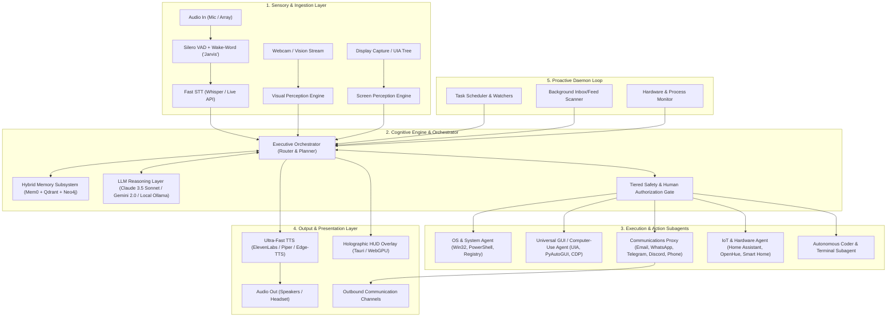
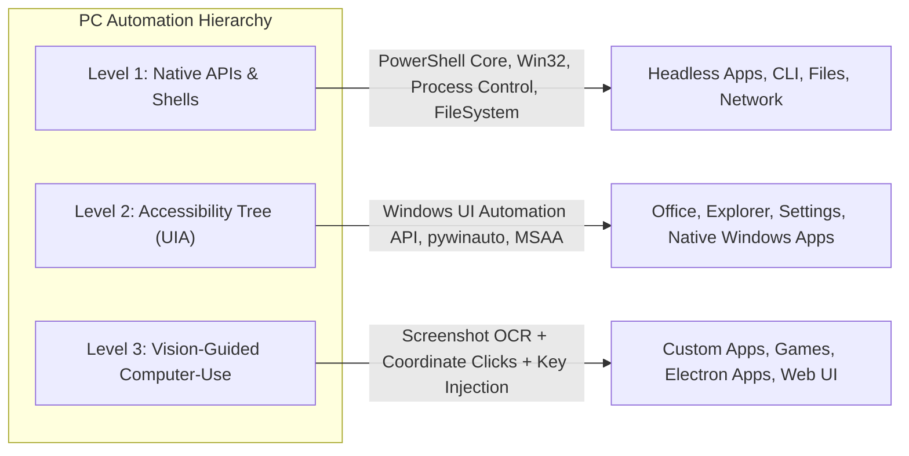
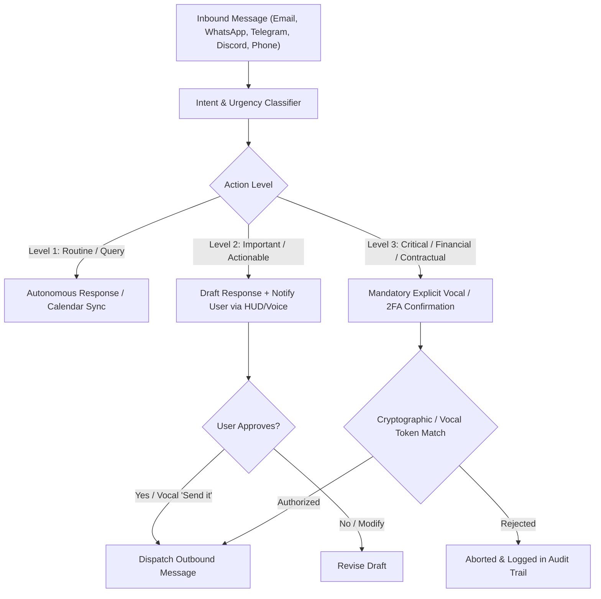
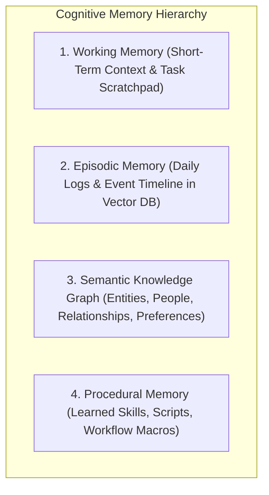
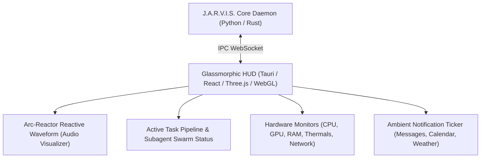
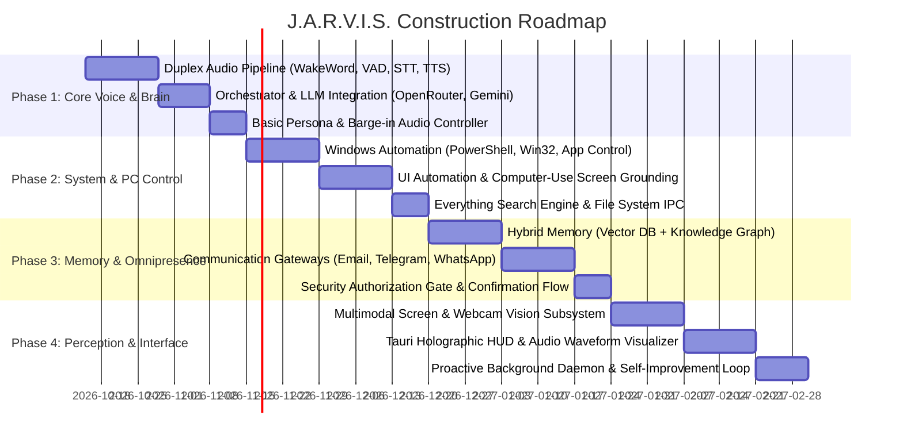

# PROJECT J.A.R.V.I.S. — Master Architectural Blueprint
**System Codename:** J.A.R.V.I.S. (*Just A Rather Very Intelligent System*)  
**Target Environment:** Windows 11 / Multi-Platform Workstation & Mobile Mesh  
**Architecture Version:** 1.0.0-PROD  

---

## 1. Executive Vision & Scope

The objective of Project J.A.R.V.I.S. is to build an autonomous, omnipresent, voice-first desktop cognitive assistant that matches the functionality depicted in the Marvel Cinematic Universe:

1. **Fluid, Duplex Spoken Conversation:** Real-time conversational streaming with sub-400ms latency, vocal barge-in (interruption handling), speaker diarization/biometrics (identifying the user vs. guests), and a refined, composed persona.
2. **Universal PC & Application Automation:** Complete control over Windows OS (files, registry, processes, network), native GUI applications (via Windows UI Automation and vision-guided Computer-Use), web browsers (CDP/Playwright), and developer tooling.
3. **Omnipresent Communication Proxy:** Communicates with clients, colleagues, and friends on behalf of the user across Email, WhatsApp, Telegram, Discord, and Phone/VoIP, with a three-tier safety authorization protocol.
4. **Cognitive Architecture & Long-Term Memory:** Hybrid memory model (Working, Episodic, Semantic Knowledge Graph, Procedural Skills) enabling J.A.R.V.I.S. to recall past conversations, adapt to user habits, and self-improve over time.
5. **Multimodal Sensory Perception:** Continuous screen understanding and real-time webcam vision for spatial awareness, gaze tracking, and physical environment perception.
6. **Proactive Background Daemon:** An autonomous background engine that monitors system vitals, tracks schedules, triages inbox messages, and alerts the user proactively without needing a prompt.
7. **Iron Man Aesthetic & Ambient Interface:** A sleek, minimalist glassmorphic HUD overlay (Tauri/Electron) featuring reactive audio waveforms, system vitals, and holographic-style visual feedback.

---

## 2. System Architecture Topology



---

## 3. Subsystem Breakdown & Technical Specifications

### Layer 1: Speech & Audio Pipeline (Duplex Audio)
To achieve natural conversation, J.A.R.V.I.S. must support **full duplex streaming** (listening while speaking and handling immediate user interruptions without lag):
* **Wake Word Engine:** `openWakeWord` or `Picovoice Porcupine` tuned to *"Jarvis"* running 100% locally with near-zero CPU footprint.
* **Voice Activity Detection (VAD):** `Silero VAD v5` for instant speech start/stop detection (<30ms latency).
* **Speaker Identification / Diarization:** `pyannote.audio` or voiceprint embedding comparison to verify if the voice is the Master (User) or a third party.
* **Speech-to-Text (STT):**
  * *Cloud/Low Latency:* Gemini Live API / Deepgram Nova-2 (<150ms time-to-first-token).
  * *Local/Offline:* Whisper.cpp (large-v3-turbo / distil-whisper) with GPU acceleration.
* **Text-to-Speech (TTS):**
  * *Cloud:* ElevenLabs (custom Paul Bettany/British voice profile with streaming chunk playback).
  * *Local Fallback:* `Piper TTS` (high quality, 20ms generation latency) or `ChatTTS` with conversational fillers (*"Right away, sir"*, *"Understood"*).
* **Audio Interruption (Barge-In) Controller:** An asynchronous audio stream coordinator. When the user speaks while J.A.R.V.I.S. is outputting audio, TTS output is instantaneously paused, the playback buffer is flushed, and the agent shifts to listening mode.

---

### Layer 2: Universal PC & Application Control

To give J.A.R.V.I.S. complete mastery over the workstation, a tri-level control system is implemented:



1. **Level 1 — Native Shell & Win32 APIs:**
   * PowerShell 7+ and CMD execution engine with stdout/stderr streaming.
   * `pywin32` / C# Win32 bindings for window management (`BringWindowToTop`, `ShowWindow`, `EnumWindows`, virtual desktop switching).
   * Filesystem indexer (integration with `Everything` search engine via IPC for instant 0-millisecond file queries across all drives).

2. **Level 2 — Semantic UI Automation (UIA):**
   * Windows Accessibility Tree API (`UIAutomationCore.dll`) via `pywinauto` or `uiautomation`.
   * Enables J.A.R.V.I.S. to read buttons, textboxes, dropdowns, menus, and window hierarchies semantically without relying purely on vision.

3. **Level 3 — Visual Computer-Use Fallback:**
   * High-speed screen capture (`mss` / Desktop Duplication API @ 60 FPS).
   * Vision model grounding (detecting coordinates `(x, y)` of arbitrary buttons, icons, or visual elements).
   * Hardware-level keyboard and mouse simulation (`pynput` / `interception` driver for games and protected applications).

4. **Web Browser Subsystem:**
   * Direct Chrome DevTools Protocol (CDP) / Playwright connection into the user's active Chrome/Edge profile (no separate bot browser needed; operates directly in existing logged-in sessions).

---

### Layer 3: Communications Proxy & Social Proxy

J.A.R.V.I.S. can act on the user's behalf across all channels with strict governance:



#### Communication Gateways:
* **Email:** Microsoft Graph API (Outlook/Office 365) + Google Workspace API (Gmail) + IMAP/SMTP fallback. Automatic email triage, thread summarization, draft generation, and attachment processing.
* **Instant Messaging:**
  * **WhatsApp:** Integration via WhatsApp Web automation / Baileys WebSocket protocol.
  * **Telegram:** `Telethon` (MTProto client operating as user account) + Telegram Bot API.
  * **Discord:** Discord User/Bot client for voice channel monitoring and server management.
  * **Slack:** Slack Bolt API / User Token for workspace communication.
* **Voice Calls / Telephony:** Twilio Voice API / SIP trunk connection with streaming Whisper + ElevenLabs for receiving and placing real phone calls on user's behalf (*"Hello, this is Mr. Stark's automated assistant calling regarding..."*).

---

### Layer 4: Cognitive Brain, Memory & Self-Learning



1. **Working Memory:** Fast in-memory state tracking current goals, subagent status, and active conversation thread.
2. **Episodic Memory:** Chronological diary of every event, user statement, decision, and system action embedded into `Qdrant` or `Chroma` vector stores with timestamp metadata.
3. **Semantic Knowledge Graph:** A graph database (`Neo4j` or embedded graph `KùzuDB` / `Mem0`) mapping:
   * *People:* Family, colleagues, clients, contact methods, communication history.
   * *Projects:* Files, deadlines, requirements, current progress.
   * *Preferences:* Working hours, tone preferences, default apps, music tastes.
4. **Procedural Memory (Skill Engine):**
   * Built-in and dynamically generated Python skills (following the Hermes Agent / Claude Code skill architecture).
   * When J.A.R.V.I.S. figures out how to perform a new multi-step task, it writes a `SKILL.md` and script to disk, verifies it, and persists it for future use.

---

### Layer 5: Multimodal Sensory Perception (Vision & Environment)

* **Continuous Screen Intelligence:**
  * Screen capture sampler (dynamic rate: 1 frame/sec idle, 10 frames/sec active task).
  * Fast local visual difference analyzer (detects when significant changes occur on screen).
  * High-capacity Vision-Language Model (`Gemini 2.0 Flash` / `Claude 3.5 Sonnet` / `Qwen2-VL-72B`) to understand code, errors, documents, diagrams, and video playback on screen.
* **Webcam & Room Perception:**
  * Face recognition & pose estimation (`MediaPipe` / `InsightFace`).
  * Gaze detection: Determines if the user is looking directly at the monitor/camera before interpreting ambient speech as commands.
  * Physical presence detection: Lock workstation when user walks away, greet user when they sit down.

---

### Layer 6: Holographic HUD Overlay & User Experience



* **Framework:** Lightweight **Tauri 2.0** desktop app configured with `transparent: true`, `always_on_top: true`, and click-through capability when in ambient mode.
* **Audio Visualizer:** Three.js / WebGL particle sphere or glowing blue/cyan arc reactor ring that reacts dynamically to microphone frequencies and TTS output speech.
* **Voice Command Popups:** Subtle notifications appearing at the screen edge showing active thoughts, command executions, and draft previews.

---

## 4. Hardware & Infrastructure Requirements

| Component | Minimum Specification | Recommended Specification |
| :--- | :--- | :--- |
| **Operating System** | Windows 10/11 64-bit | Windows 11 Pro 64-bit |
| **Processor (CPU)** | Intel Core i7 / AMD Ryzen 7 (8 cores) | Intel Core i9 / AMD Ryzen 9 / Threadripper |
| **Graphics (GPU)** | NVIDIA RTX 3060 (12GB VRAM) | NVIDIA RTX 4080 / 4090 (16–24GB VRAM) |
| **System Memory (RAM)** | 32 GB DDR4/DDR5 | 64 GB DDR5 |
| **Audio Hardware** | Standard USB Headset or Mic | Multi-microphone array (boundary mic with noise cancellation) |
| **Vision Hardware** | 1080p USB Webcam | 4K Wide-Angle Webcam with Windows Hello / IR sensor |
| **Storage** | 100 GB NVMe SSD | 500 GB NVMe PCIe Gen4 SSD |

---

## 5. Phased Implementation Roadmap



---

## 6. Directory Structure for the Project

```text
Jarvis AI/
├── ARCHITECTURE.md                  # This master blueprint document
├── config/
│   ├── jarvis_config.yaml          # Master configuration (thresholds, hardware, channels)
│   └── persona.prompt              # Personality prompt & tone instructions
├── core/
│   ├── orchestrator.py             # Central executive dispatcher
│   ├── memory/                     # Semantic, episodic, and working memory engines
│   │   ├── knowledge_graph.py
│   │   └── vector_store.py
│   ├── safety/                     # Action authorization gates & audit logger
│   └── daemons/                    # Background watchers, cron, and event listeners
├── speech/
│   ├── wakeword.py                 # "Jarvis" hotword detector
│   ├── vad.py                      # Voice Activity Detection
│   ├── stt_stream.py               # Streaming Speech-to-Text
│   ├── tts_stream.py               # Streaming Text-to-Speech
│   └── audio_duplex.py             # Full-duplex audio stream & barge-in manager
├── automation/
│   ├── os_controller.py            # Windows shell, processes, files
│   ├── uia_controller.py           # Accessibility tree automation
│   ├── browser_controller.py       # CDP & Playwright automation
│   └── computer_use.py             # Screen coordinate grounding & vision actions
├── communications/
│   ├── email_proxy.py              # Outlook & Gmail integration
│   ├── messaging/                  # WhatsApp, Telegram, Discord adapters
│   └── telephony.py                # Twilio VoIP calling engine
├── vision/
│   ├── screen_watcher.py           # Real-time display perception
│   └── camera_stream.py            # Webcam, face identification & gaze tracking
├── skills/                         # Procedural memory / extensible tool library
├── hud/                            # Tauri / WebGL Holographic UI desktop app
└── tests/                          # Integration & regression test suites
```
