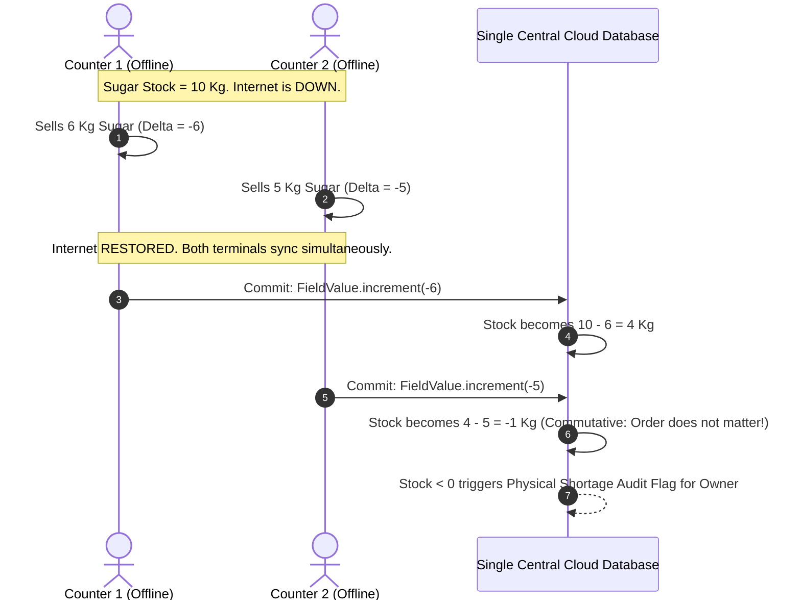

# 🏛️ System Architecture Blueprint — Master Technical Architecture
## Project: LedgerX Desktop — Native Desktop Multi-Tenant ERP & Khata
**Document Version:** 6.0.0-PROD-MASTER-ENTERPRISE  
**Architect:** Lead System Architect & Senior Implementation Engineer  
**Architecture Pattern:** Desktop Local-First Architecture, Commutative Delta CRDT, Single-DB Multi-Tenancy  
**Production Runtime:** Electron 34 (Sandboxed Preload) / NSIS Windows x64 Native Installer  
**Cloud Cost Strategy:** 95% Read-Reduction Aggregate Pattern on Single Cloud Database  

---

## 1. Production Desktop Runtime & Native Hardware Spooling

LedgerX Desktop targets retail POS terminals and desktop PCs running Windows 10/11 (64-bit). The architecture enforces strict **Process Sandboxing** and **Direct Win32 Hardware Access**:

```mermaid
graph TB
    subgraph HostProcess ["Desktop Native Host Process (Node.js 22 + Win32 C++ Addons)"]
        LifeCycle[Main Window & Lifecycle Manager]
        WinSpooler[Win32 Direct Print Spooler (winspool.drv)]
        DrawerKick[Cash Drawer Solenoid Kick Controller]
        BarcodeHook[Low-Level Windows Keyboard Interceptor]
        LocalWAL[(Local Embedded SQLite / IndexedDB Cache)]
        SyncWorker[Background Cloud Sync Worker]
        AudioSynthesizer[Offline Bengali Audio Vocalizer Engine]
    end

    subgraph RendererProcess ["Sandboxed Renderer Process (React 19 + bKash UI)"]
        bKashUI[bKash Visual UI & 8-Tile Action Grid]
        NumpadEngine[100% Numpad-Only Rush-Hour Controller]
        BilingualBridge[Bilingual i18n Engine: বাংলা ⇄ English]
        MushakEngine[NBR Mushak 6.3 VAT Tax Generator]
        PreloadIPC[Context-Isolated Preload Bridge]
    end

    subgraph CentralCloud ["Single Central Cloud Database (Cloud Firestore)"]
        SecurityFirewall[Kernel-Level Tenant Isolation Rules]
        DailySummaryDoc["/aggregates/daily_summary (Atomic Increments)"]
        TenantCollections["/tenants/{tenantId}/* (Partitions)"]
    end

    RendererProcess <-->|Whitelisted Preload IPC| PreloadIPC
    PreloadIPC <-->|Typed IPC Channels| HostProcess
    HostProcess --> WinSpooler
    WinSpooler --> PhysicalPrinter[58mm/80mm USB Thermal Printer]
    HostProcess --> DrawerKick
    DrawerKick --> CashDrawer[RJ11/USB 24V Physical Cash Drawer]
    BarcodeHook --> HostProcess
    HostProcess <--> LocalWAL
    SyncWorker <-->|TLS 1.3 Sync Queue| SecurityFirewall
    SecurityFirewall <--> DailySummaryDoc
    SecurityFirewall <--> TenantCollections
```

---

## 2. Cloud Cost Optimization: The 95% Read-Reduction Engine

Cloud databases (such as Firestore) bill per document read. If a Paikari store with 25,000 transactions opens their app and naive `onSnapshot()` listeners query raw collections, the merchant or cloud bill racks up millions of reads daily.

LedgerX Desktop solves this through a **Three-Tier Read Shield**:
1. **Tier 1 — Local Disk Read Shield ($0 Cost):**
   - 100% of daily UI reads (Customer Khata lists, Product search, Cashbox balances) are served from local disk storage (SQLite/IndexedDB). Zero cloud reads are triggered during standard operations.
2. **Tier 2 — Denormalized Daily Summary Aggregate (`daily_summary`):**
   - Instead of summing 1,000 transactions to display the bKash Master Balance Card, the cloud engine maintains a single aggregate document per tenant:
     `/tenants/{tenantId}/aggregates/daily_summary`
   - Every transaction updates this document using atomic increments (`FieldValue.increment()`).
   - Loading the home dashboard takes **exactly 1 document read** instead of 1,000 reads!
3. **Tier 3 — Timestamp Cursor Pagination:**
   - Any historical ledger query strictly enforces `limit(30)` with cursor pagination (`startAfter`).

---

## 3. Concurrency & Offline Conflict Resolution: Commutative Delta CRDT

When two offline desktop terminals (Counter 1 and Counter 2) sell products or record credit simultaneously while the market broadband is down:



### 3.1 Mathematical Commutativity Proof
Because addition and subtraction are commutative ($A + B = B + A$):
$$\text{Final Stock} = \text{Initial Stock} + \sum \Delta \text{Terminal}_i$$
Neither terminal's sale is discarded or overwritten. The state converges deterministically without lock contention.

---

## 4. Hardware Driver Specifications: Win32 Spooler & Drawer Solenoid

### 4.1 USB Cash Drawer Solenoid Kick Pulse
To pop open the physical cash drawer automatically upon finalizing a cash sale, the desktop driver sends a 24V 50ms pulse to the printer's RJ11 kick port:
```javascript
// ESC/POS Cash Drawer Kick Command: ESC p m t1 t2
// m = 0 (Pin 2), t1 = 25 (50ms on), t2 = 250 (500ms off)
const KICK_DRAWER_PULSE = new Uint8Array([0x1B, 0x70, 0x00, 0x19, 0xFA]);

export function kickCashDrawer(printerPort) {
  win32Spooler.writeRaw(printerPort, KICK_DRAWER_PULSE);
}
```

### 4.2 Barcode Scanner Keystroke Wedge Normalizer
USB barcode scanners emit characters rapidly followed by a suffix. The low-level Windows hook normalizes variations across Chinese/Honeywell/Zebra scanners:
- Filters out non-printable ASCII.
- Normalizes both `\r` (CR) and `\n` (LF) into a standardized `SCANNER_INPUT_COMPLETE` event in < 1ms.

---

## 5. Built-in Offline Bengali Audio Voicebox Engine

The desktop app vocalizes transactions through a dedicated lightweight audio sprite engine:
- Synthesizes numbers (`১` to `৯৯,৯৯৯`) and phrases using high-fidelity offline audio clips.
- Does NOT require internet connection or cloud speech API subscriptions.
- Audio latency: < 50 milliseconds from hitting `Enter` to voice playback.

```javascript
// src/utils/bengaliVoicebox.js
export function vocalizeTransaction(type, amountTaka, partyName) {
  if (!settings.audioEnabled) return;
  // Plays: "[partyName] er [amountTaka] taka joma hoyeche"
  audioSpriteEngine.playSequence([
    { clip: 'party_prefix', text: partyName },
    { clip: 'amount', value: amountTaka },
    { clip: 'taka_joma_hoyeche' }
  ]);
}
```

---

## 6. Zero-Cost WhatsApp Desktop Integration Architecture

```javascript
// electron/main.js
ipcMain.handle('system:open-whatsapp', async (event, { phone, message }) => {
  // Sanitize phone number (e.g. 01700000000 -> 8801700000000)
  const cleanPhone = phone.replace(/[^0-9]/g, '').replace(/^0/, '880');
  const encodedText = encodeURIComponent(message);
  const whatsappUrl = `whatsapp://send?phone=${cleanPhone}&text=${encodedText}`;
  
  // Triggers installed WhatsApp Desktop application directly (৳0 API cost)
  await shell.openExternal(whatsappUrl);
  return { success: true };
});
```

---

## 7. NBR Mushak 6.3 Tax Invoice Specification

When Mushak 6.3 Mode is active, the invoice engine formats thermal or A4 receipts according to National Board of Revenue (NBR) Form 6.3 regulations:
```
======================================================
               গণপ্রজাতন্ত্রী বাংলাদেশ সরকার
                  জাতীয় রাজস্ব বোর্ড
           কর চালানপত্র (বিধি ৪০ এর উপবিধি (১))
                    মূসক - ৬.৩
======================================================
নিবন্ধিত ব্যক্তির নাম: বিসমিল্লাহ ট্রেডার্স
বিআইএন (BIN): ০০০১২৩৪৫৬-০১০১
চালানপত্র নম্বর: M-2026-0042      ইস্যুর তারিখ: ১৫-১০-২০২৬
ক্রেতার নাম: মো: রহিম মিয়া          ক্রেতার টিআইএন: ১২৩৪৫৬৭৮৯
ক্রেতার ঠিকানা: নিউ মার্কেট, ঢাকা    যানবাহনের প্রকৃতি: ভ্যান
------------------------------------------------------
পণ্য বিবরণ     একক  পরিমাণ   মূল্য (৳)   সম্পূরক শুল্ক  মূসক (১৫%)
------------------------------------------------------
মিনিকেট চাল   কেজি   ৫০     ৪,০০০.০০       ০.০০      ৬০০.০০
সয়াবিন তেল    লিটার  ১০     ১,৬০০.০০       ০.০০      ২৪০.০০
------------------------------------------------------
সর্বমোট মূসক (Total VAT):                        ৳ ৮৪০.০০
সর্বমোট মূল্য (করসহ মোট মূল্য):                 ৳ ৬,৪৪০.০০
------------------------------------------------------
দায়িত্বপ্রাপ্ত কর্মকর্তার স্বাক্ষর: ____________________
======================================================
```
