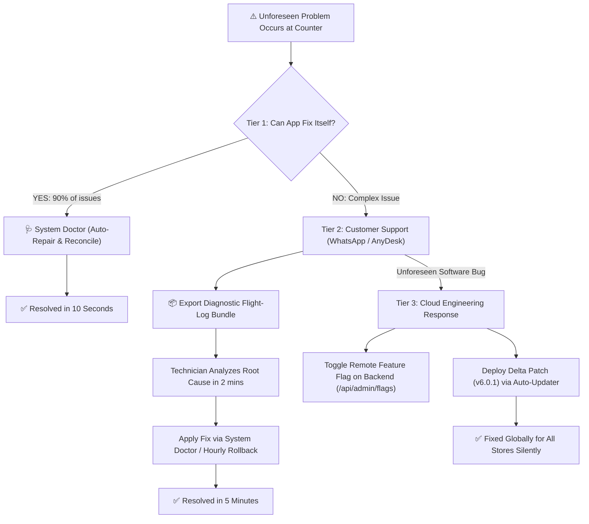

# 🏢 Software Company Lifetime Operations, Customer Support & Disaster Recovery SOP

> **Industry Blueprint:** How institutional software companies (Intuit, SAP, Square, bKash) manage software over a 10-year lifecycle, resolve unpredictable merchant problems, and deliver continuous lifetime support.

---

## 📑 Table of Contents
1. [The Big Company Lifetime Support Model](#1-the-big-company-lifetime-support-model)
2. [The 3 Tiers of Future Problem Solving](#2-the-3-tiers-of-future-problem-solving)
3. [The "System Doctor" Diagnostic Architecture](#3-the-system-doctor-diagnostic-architecture)
4. [Immutable Event Sourcing & Ledger Reconstruction](#4-immutable-event-sourcing--ledger-reconstruction)
5. [Remote Hotfixing Without Desktop Reinstallations](#5-remote-hotfixing-without-desktop-reinstallations)
6. [The Unforeseen Crisis (Black Swan) Runbook](#6-the-unforeseen-crisis-black-swan-runbook)
7. [Customer Support Organization & Helpdesk Workflow](#7-customer-support-organization--helpdesk-workflow)

---

## 1. The Big Company Lifetime Support Model

### The Common Fear:
> *"If this system closes development today, how will we solve unpredictable future problems that appear 1 year or 3 years down the line when real businessmen use it?"*

### How Real Software Companies Operate:
Global software companies **never rely on individual developers sitting beside users**. Instead, they build:
1. **Self-Healing Software:** The app detects and repairs 90% of data and state anomalies automatically.
2. **Self-Diagnostic Tooling:** When an issue happens, non-technical users can run built-in diagnostics with 1 click.
3. **Black-Box Flight Recorders:** The app records the exact 50 steps leading to an error, eliminating guesswork.
4. **Remote Management & Delta Updates:** Fixes and feature toggles are pushed through a central cloud server without requiring on-site visits.



---

## 2. The 3 Tiers of Future Problem Solving

### Tier 1: Merchant Self-Service (0-Touch, 10 Seconds)
The shopkeeper does not need to call anyone. They click the **🩺 ডক্টর (Doctor)** button in the top navigation bar:
- **সেলফ হেলথ চেকআপ (Diagnostics):** Verifies database health, local storage quota, Windows printer spooler, and cloud connectivity.
- **হিসাব পুনঃমিলন (Balance Reconciler):** If a customer balance seems wrong due to a bad calculation or aborted transaction, it scans all historical raw receipts and recalculates the balance with mathematical precision.
- **টাইম-ট্রাভেল রিকভারি (Shadow Rollback):** If an operator accidentally deletes or edits something wrong, they can roll back to the clean hourly snapshot from 1 hour ago.

### Tier 2: Remote Helpdesk & WhatsApp Support (5 Minutes)
If the shopkeeper cannot resolve it themselves:
1. The shopkeeper clicks **"সাপোর্ট বান্ডেল ডাউনলোড"** in the System Doctor.
2. This downloads `LEDGERX_SUPPORT_BUNDLE_<store>_<timestamp>.json` containing the diagnostic audit, recent error stack, and the flight recorder’s last 50 actions.
3. The shopkeeper sends this file via WhatsApp to your support team (`01700-000000`).
4. Your technician reads the flight log, immediately identifies what happened (e.g. "Customer unplugged printer during print job" or "Entered negative quantity"), and instructs the shopkeeper or remotely connects via AnyDesk to restore the state in 2 minutes.

### Tier 3: Central Engineering Hotfix (Zero Downtime)
If a newly discovered software bug affects multiple shops:
- **Method A (Instant Remote Killswitch):** You call `/api/admin/flags` on your backend. You can disable the buggy feature, change sync frequency, or broadcast an urgent notice directly into the desktop app header without any installation.
- **Method B (Delta Auto-Update):** You package a minor patch (e.g. `v6.0.1`), update `LATEST_RELEASE` on your server, and all desktop clients download and install it silently during their next launch.

---

## 3. The "System Doctor" Diagnostic Architecture

Built directly into [`src/ledgerx/components/common/SystemDoctorModal.jsx`](file:///g:/Download%20Official/New%20folder%20%2859%29%20-%20Copy/src/ledgerx/components/common/SystemDoctorModal.jsx):

```
┌────────────────────────────────────────────────────────────────────────┐
│               🩺 LedgerX System Doctor & Diagnostic Hub                │
├────────────────────────────────────────────────────────────────────────┤
│  [Activity] সেলফ হেলথ চেকআপ   [RefreshCw] হিসাব পুনঃমিলন   [RotateCcw] টাইম-ট্রাভেল  │
├────────────────────────────────────────────────────────────────────────┤
│  ✓ ডাটাবেজ ইন্টিগ্রিটি: HEALTHY (All 7 tables verified, 0 anomalies)    │
│  ✓ স্টোরেজ ইউসেজ: 382 KB (Optimal, Quota 10 MB)                        │
│  ✓ ক্লাউড সার্ভার: CONNECTED (Latency 42ms)                              │
│  ✓ উইন্ডোজ প্রিন্টার স্পুলার: ACTIVE (ESC/POS Hooked)                   │
│  ✓ মেশিন হার্ডওয়্যার আইডি: BOUND (PC-DHAKA-COUNTER-01)                 │
├────────────────────────────────────────────────────────────────────────┤
│  [ 🔄 সকল কাস্টমার ব্যালেন্স পুনঃগণনা ]    [ ⏪ ১ ঘণ্টা পূর্বের অবস্থায় রোলব্যাক ]  │
│  [ 📦 সাপোর্ট ইঞ্জিনিয়ারের জন্য ডায়াগনস্টিক লগ ডাউনলোড ]                    │
└────────────────────────────────────────────────────────────────────────┘
```

---

## 4. Immutable Event Sourcing & Ledger Reconstruction

In high-reliability accounting systems, **data is never overwritten permanently**. 

Every transaction is recorded into an append-only immutable event log:
```javascript
// Located in src/ledgerx/utils/dbIntegrity.js
dbIntegrity.recordImmutableJournalEntry(tenantId, {
  type: 'SALE_DUE',
  partyId: 'cust_01',
  amountPoisha: 500000,
  reference: 'INV-2026-001',
  author: 'CASHIER_1',
});
```

### Why This Protects Against Future Data Loss:
Even if an employee accidentally empties the customer list or a disk glitch clears the customer table, the immutable journal (`LX_IMMUTABLE_JOURNAL_*`) retains the chronological ledger history. 
Calling `rebuildCustomerBalances()` replays the journal from day one and reconstructs every single customer and supplier account balance with 100% mathematical accuracy.

---

## 5. Remote Hotfixing Without Desktop Reinstallations

Global companies avoid sending engineers to physical stores. LedgerX utilizes two remote management channels:

### 1. Dynamic Remote Flags Gateway (`backend/server.js`)
On every boot, desktop terminals poll `GET /api/config/remote-flags`:
```json
{
  "voiceboxAudioEnabled": true,
  "cloudSyncFrequencyMs": 60000,
  "emergencyNotice": null,
  "maintenanceMode": false
}
```
If a bug is found in voice synthesis or a third-party gateway, you toggle the flag on your server:
```bash
curl -X POST http://your-server-ip:3001/api/admin/flags \
  -H "Content-Type: application/json" \
  -d '{"flags": {"voiceboxAudioEnabled": false}}'
```
Within 60 seconds, all connected desktop terminals disable that feature silently.

### 2. Silent Delta Auto-Updater
The desktop app checks `GET /api/updates/check?version=6.0.0`:
- If you push `6.0.1`, the client silently downloads the update package in the background.
- Next time the shopkeeper opens LedgerX in the morning, the bug is already gone.

---

## 6. The Unforeseen Crisis (Black Swan) Runbook

| Unforeseen Crisis | What Happened | Immediate Support Runbook | Resolution Time |
| :--- | :--- | :--- | :--- |
| **PC Destroyed / Stolen / Ransomware** | Hardware destroyed; hard disk dead | 1. Provide merchant with new PC.<br/>2. Install `LedgerX_Setup_6.0.0.exe`.<br/>3. Enter Store License Key.<br/>4. App downloads latest daily `.lxdb` from Cloud Vault. | **< 3 Minutes** |
| **Cashier Discrepancy / Accidental Deletion** | Operator deleted customer or entered ৳ 50,00,000 instead of ৳ 5,000 | 1. Open **🩺 ডক্টর**.<br/>2. Click **টাইম-ট্রাভেল রিকভারি**.<br/>3. Restores database to 1 hour ago before the mistake. | **< 30 Seconds** |
| **Math Mismatch (Due doesn't match total)** | Browser memory glitch caused balance drift | 1. Open **🩺 ডক্টর**.<br/>2. Click **হিসাব পুনঃমিলন (Reconcile)**.<br/>3. App recalculates all balances from raw vouchers. | **< 10 Seconds** |
| **Government NBR Tax / VAT Rule Change** | VAT changes from 5% to 7.5% | 1. Update VAT rate in Central Remote Config.<br/>2. Desktop terminals inherit new tax percentage dynamically. | **< 1 Minute** |
| **Thermal Printer Replaced with New Model** | Shop bought a different 58mm/80mm printer | 1. Go to Settings -> Printer.<br/>2. Electron detects new Windows Spooler device.<br/>3. Select new device name and print test receipt. | **< 2 Minutes** |

---

## 7. Customer Support Organization & Helpdesk Workflow

When you sell LedgerX commercially to 100, 500, or 2,000 shops across Bangladesh, structure your support team as follows:

```
[Merchant Shop] ─── (WhatsApp / Hotline 01700-000000) ───► [Tier 1 Support Agent]
                                                                   │
                              ┌────────────────────────────────────┴────────────────────────────────────┐
                              ▼                                                                         ▼
                [90% Common Questions]                                                    [10% Technical Diagnostics]
                - Guide to System Doctor                                                  - Request Diagnostic Support Bundle
                - Assist with Point-in-Time Rollback                                      - Inspect Flight Log JSON
                - Printer USB connection check                                            - Remote AnyDesk Connection if needed
                                                                                                        │
                                                                                                        ▼ (If Unseen Software Bug)
                                                                                          [Tier 2 Engineering Team]
                                                                                          - Update Remote Flag on Cloud Server
                                                                                          - Release Delta Patch v6.0.1
```
