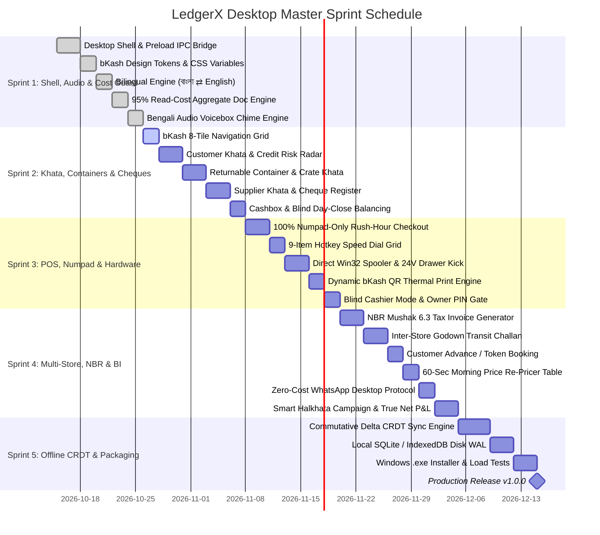

# 🗺️ Implementation Roadmap & Phased Execution Plan — Master Sprints
## Project: LedgerX Desktop — Native Desktop Multi-Tenant ERP & Khata
**Document Version:** 6.0.0-PROD-MASTER-ENTERPRISE  
**Author:** Lead Architect, Product Manager & QA Reliability Engineer  
**Sprint Cadence:** 5 Agile Sprints with Strict Verification & QA Gates  

---

## 1. Master Implementation Roadmap Overview

The execution roadmap includes the **Enterprise-Grade Capabilities**: 100% Numpad Rush-Hour Mode, Bengali Audio Voicebox, 95% Read-Cost Optimization, and NBR Mushak 6.3 Compliance.

---

## 2. Institutional Quality Gates & Test Suites

| Test Suite | Scenario Tested | Pass Criteria |
| :--- | :--- | :--- |
| **TS-1: Rush-Hour Speed** | Complete POS sale using physical Numpad only without touching mouse | Sale finalized, receipt printed, and cash drawer kicked in < 3.0s total. |
| **TS-2: Audio Voicebox** | Record ৳ 1,250 Pabo from customer Rahim | Voicebox vocalizes: *"রহিম মিয়ার এক হাজার দুইশত পঞ্চাশ টাকা জমা হয়েছে"* in < 50ms. |
| **TS-3: Cloud Cost Audit** | 500 sales recorded on active terminal | Total cloud database reads <= 5 (verified via read-shield cache). |
| **TS-4: CRDT Concurrency** | 2 offline terminals sell 6kg and 5kg of an item with 10kg initial stock | On reconnect, both sales commit; final stock is -1kg; audit alert generated. |
| **TS-5: NBR Mushak 6.3** | Generate tax invoice with 15% VAT | BIN/TIN printed; VAT calculation matches exact integer poisha arithmetic. |
| **TS-6: Zero-Cost WhatsApp**| Click "Send Reminder" on Customer Khata | WhatsApp Desktop launches with pre-filled message; zero API fees charged. |
