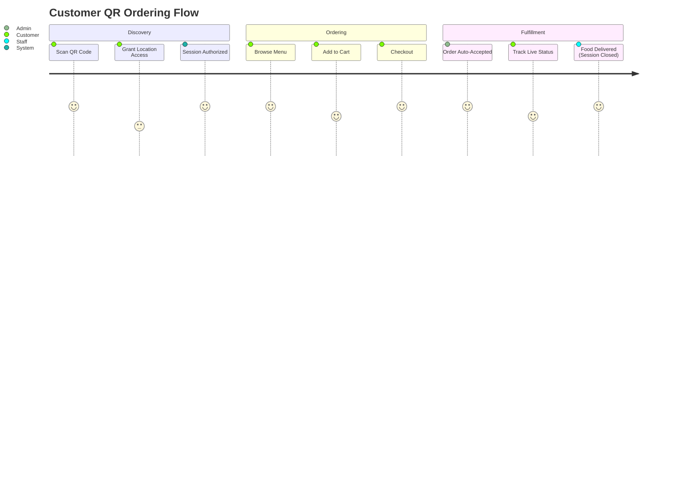
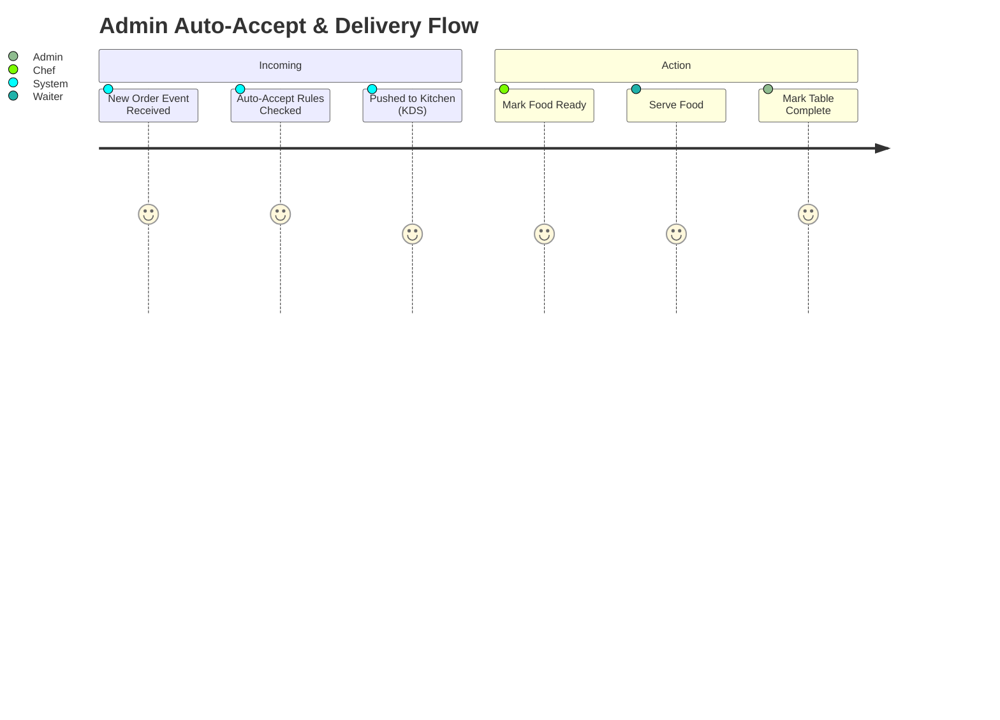

# Product Requirements Document (PRD) - Evorise Restaurant System
**Version:** 1.0.0 | **Status:** DRAFT | **Project:** Evorise Restaurant Management System

---

## 1. Document Control & Glossary
- **Geofencing:** A virtual geographic boundary defined by GPS technology.
- **BLE Beacon:** Bluetooth Low Energy transmitter used for indoor positioning (floor-level accuracy).
- **OMS:** Order Management System (The Admin portal).
- **KDS:** Kitchen Display System.
- **Session:** A temporary, secure connection bound to a specific table, device, and physical location.

---

## 2. Product Vision & Scope
To build the most resilient, secure, and high-performance restaurant ordering system in the market. The system must completely eliminate the friction of user login while deploying military-grade security to prevent fraud, remote ordering, and system crashes under extreme load (e.g., thousands of simultaneous table scans during a rush hour).

---

## 3. Detailed Functional Requirements

### 3.1 Customer Experience (QR Ordering)
**FR-1.0: Session Initialization & Geofence Validation**
- **Flow:** User scans QR code -> Browser prompts for Location access (HTML5 Geolocation).
- **Validation:** System compares user coordinates against restaurant coordinates. Must be within X meters (configurable in admin panel).
- **Micro-location:** If floor-level security is enabled, the browser uses Web Bluetooth API (or native wrapper) to scan for the floor's BLE beacon.
- **Result:** Generates a secure, 2-hour TTL JWT token. No sign-up required.

**FR-1.1: Digital Menu Navigation**
- **Categorization:** Sticky category tabs at the top (Starters, Mains, Drinks).
- **Performance:** Menu images must be webp/avif formats, lazy-loaded, and served via edge CDN. Scrolling must maintain 60fps.
- **Search & Sort:** Real-time client-side fuzzy search (using libraries like Fuse.js) to prevent server round-trips. 

**FR-1.2: Cart & Checkout**
- **State Persistence:** Cart state is maintained in `localStorage`.
- **Idempotent Checkout:** Prevent double-ordering if network lags and user spams the 'Place Order' button.
- **Offline Tolerance:** If network drops during checkout, the app queues the request and visually informs the user.

**FR-1.3: Live Order Tracking**
- **UI:** A visual 4-step stepper (Pending -> Preparing -> Ready -> Delivered).
- **Updates:** Powered by WebSockets. No manual refreshing required.

### 3.2 Admin / Staff OMS (Order Management System)
**FR-2.0: Order Triage Dashboard**
- **Views:** Kanban board style (New Orders, In Kitchen, Ready to Serve).
- **Auto-Accept Mode:** Toggle switch in settings. When ON, orders bypass 'New Orders' and go straight to 'In Kitchen' (and print on KDS).
- **Shift Management:** Auto-accept can be scheduled (e.g., 12 PM - 2 PM lunch rush).

**FR-2.1: Table & Session Management**
- **Grid View:** Visual layout of tables. Green (Available), Red (Occupied/Active Session).
- **Force Close:** Staff can manually terminate a table's session to kick off lingering devices and clear the table for new guests.
- **Auto-Reset:** Marking an order as "Delivered" and fully paid automatically terminates the customer's session token and resets the table to Green.

### 3.3 POS (Point of Sale) Integration
**FR-3.0: Unified Billing**
- Orders placed via QR code merge with orders placed manually by staff into a single invoice.
- **Invoice Engine:** Generates tax-compliant PDF invoices using a highly optimized template engine (e.g., Puppeteer/Playwright rendering backend).
- **Print API:** Direct integration with ESC/POS thermal printers via local network middleware.

### 3.4 Deep Analytics Panel
**FR-4.0: Core Metrics**
- Live Revenue Today (updated via WebSockets).
- Average Order Value (AOV).
- Table Turnaround Time (from session start to order delivered).
- Top 10 Best Sellers.

**FR-4.1: Custom Filtering**
- Date range picker (Custom ranges, This Month, YTD).
- Cross-filtering by category (e.g., "Show me top selling drinks during lunch hours").
- Export to CSV/Excel functionality processed via asynchronous background jobs (with email delivery for large datasets).

---

## 4. Non-Functional Requirements (NFRs)

### 4.1 Scalability & Performance Limits
- **Concurrent Users:** Must handle up to 100,000 concurrent active WebSocket connections per cluster.
- **Latency:** API response times (99th percentile) must be under 200ms for all non-computational endpoints.
- **Throughput:** Capable of processing 5,000 orders per second globally without data loss (via Kafka queuing).

### 4.2 Security Standards
- **OWASP Top 10:** Strict protection against XSS, CSRF, and SQL Injection.
- **DDoS Resiliency:** The API Gateway must implement IP-based and Table-based token-bucket rate limiting.
- **Zero Trust:** Every internal microservice-to-microservice call must be authenticated via mutual TLS (mTLS).

---

## 5. User Journey Maps (Mermaid)

### Customer Order Journey

### Admin Operations Journey

---
*End of PRD Document. Prepared by Product Team.*
