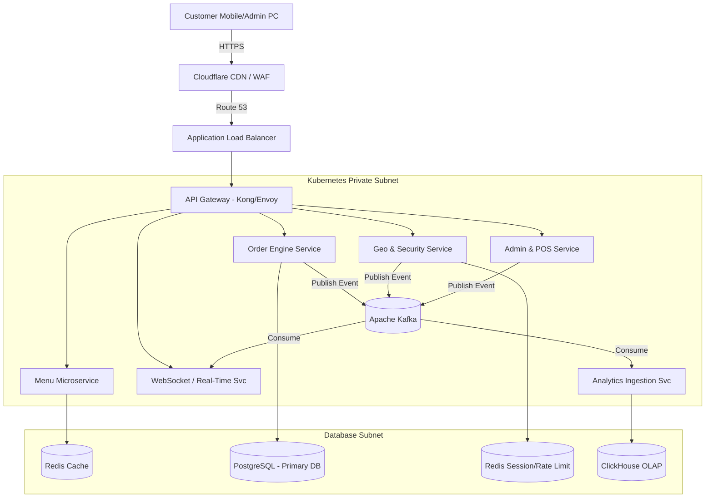
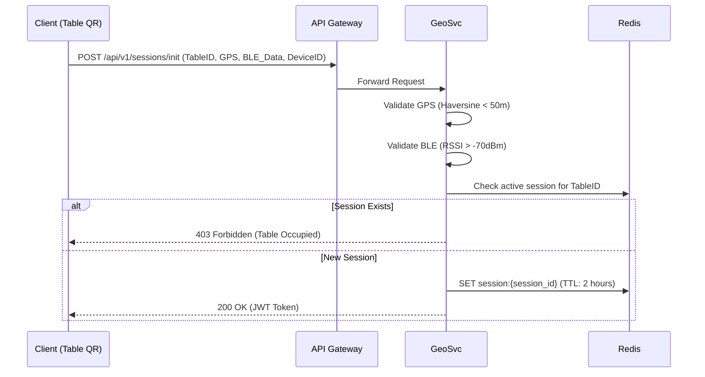

# Comprehensive System Architecture Specification
**Version:** 1.0.0 | **Status:** DRAFT | **Project:** Evorise Restaurant Management System

---

## 1. Executive System Overview
This document outlines the detailed architecture for the Evorise Restaurant Management System, designed to handle extreme scale (millions of concurrent users/clicks) while maintaining strict security perimeters (geofencing, floor-level validation, anti-fraud). The system utilizes a cloud-native, event-driven microservices architecture deployed on Kubernetes (K8s).

---

## 2. Infrastructure & Network Topology

### 2.1 Cloud Provider & Edge Network
- **Edge / CDN:** Cloudflare Enterprise.
  - **WAF Rules:** Blocks known bad IPs, SQL injection, XSS. Custom rules to drop requests without a valid `Evorise-Client-ID` header.
  - **DDoS Mitigation:** Layer 3/4 network protection and Layer 7 HTTP flood protection.
  - **Caching:** Menu assets, images, and static frontend bundles are cached globally. Edge caching TTL set to 5 minutes with programmatic cache invalidation via Cloudflare API upon admin menu updates.
- **VPC (Virtual Private Cloud):** 
  - **Public Subnet:** Application Load Balancers (ALB), NAT Gateways.
  - **Private Subnet:** EKS (Elastic Kubernetes Service) worker nodes, Redis Clusters, Kafka Brokers.
  - **Database Subnet:** RDS Postgres, ClickHouse clusters. (No direct internet access).

### 2.2 Network Flow Diagram


---

## 3. Microservices Architecture Detailed Specs

### 3.1 Session & Security Service (GeoSvc)
Responsible for issuing JWTs, verifying physical presence, and rate-limiting.
- **Geofencing Algorithm:** Implements the Haversine formula to calculate the distance between the restaurant's fixed coordinates and the client's reported GPS coordinates.
  - *Tolerance:* 50 meters (configurable per restaurant).
- **Floor-Level Validation (Micro-location):**
  - Uses Bluetooth Low Energy (BLE) beacons installed on each floor.
  - The client PWA/App scans for specific BLE UUIDs and transmits the RSSI (Received Signal Strength Indicator) to the backend.
  - Algorithm checks if `RSSI > -70dBm` matching the designated floor beacon to authorize the session.
- **Session Issuance Flow:**


### 3.2 Order Engine Service (OrderSvc)
Handles the transactional creation and state machine of orders.
- **Language:** Go (Golang) for high concurrency and low memory footprint.
- **Idempotency:** Uses `Idempotency-Key` headers to prevent double-charging or duplicate orders if the customer spams the "Order" button.
- **State Machine:**
  - `PENDING_ACCEPTANCE` -> `PREPARING` -> `READY` -> `DELIVERED` -> `CLOSED`.

### 3.3 WebSocket Real-Time Service (WSSvc)
- Maintains persistent TCP connections with both the Customer (Tracking Screen) and the Admin (Dashboard).
- **Pub/Sub Backplane:** Uses Redis Pub/Sub to sync WebSocket connections across multiple K8s pods. If Pod A holds the customer connection and Pod B holds the admin connection, they communicate via Redis.

---

## 4. Database Schema Details

### 4.1 PostgreSQL (Transactional Data)
**Table: `restaurants`**
- `id` (UUID, PK)
- `name` (VARCHAR)
- `lat` (DECIMAL 9,6)
- `lng` (DECIMAL 9,6)
- `geofence_radius` (INTEGER)

**Table: `tables`**
- `id` (UUID, PK)
- `restaurant_id` (UUID, FK, Indexed)
- `table_number` (VARCHAR)
- `floor` (INTEGER)
- `ble_beacon_uuid` (VARCHAR)

**Table: `orders`**
- `id` (UUID, PK)
- `table_id` (UUID, FK)
- `session_id` (VARCHAR, Indexed)
- `status` (ENUM: PENDING, PREPARING, DELIVERED, CANCELLED)
- `total_amount` (DECIMAL 10,2)
- `created_at` (TIMESTAMP)

### 4.2 Redis (In-Memory State & Rate Limiting)
- **Token Bucket Rate Limiting:**
  - Key: `rate_limit:ip:{ip_address}` or `rate_limit:table:{table_id}`
  - Structure: Hash (`tokens_left`, `last_refill`)
  - Limit: 10 requests / second for ordering API.
- **Active Sessions:**
  - Key: `session:{table_id}` -> Value: `{ session_jwt, device_id, started_at }`

### 4.3 ClickHouse (Analytics OLAP)
- Highly denormalized tables optimized for time-series queries.
- **Table: `order_events`** (Engine: MergeTree)
  - `timestamp` (DateTime)
  - `restaurant_id` (UUID)
  - `item_id` (UUID)
  - `revenue` (Float32)
  - `order_duration_seconds` (UInt32)
- *Partitioned by Month, Ordered by `restaurant_id, timestamp` for instant dashboard loading.*

---

## 5. High Availability & Fault Tolerance

### 5.1 Auto-Scaling Strategy
- **HPA (Horizontal Pod Autoscaler):** Scales K8s pods based on CPU utilization > 70% or active HTTP request queues.
- **KEDA (Kubernetes Event-driven Autoscaling):** Scales `OrderSvc` consumers based on the lag in the Apache Kafka topics. If a million orders hit at once, Kafka absorbs the shock (acting as a buffer), and KEDA spins up 100+ worker pods to process the backlog rapidly without dropping a single order.

### 5.2 Circuit Breaking
- Implemented via Istio/Envoy service mesh.
- If the `POS Service` (which communicates with physical hardware) takes > 2 seconds to respond or throws 5xx errors, the circuit trips. The `Order Engine` gracefully degrades by logging the order to the database but returning a fallback response to the user, ensuring the system never fully locks up.

---

## 6. Security & Anti-Fraud Mechanisms

- **Device Fingerprinting:** Generates a unique hash based on browser headers, canvas fingerprinting, and hardware concurrency to detect bots.
- **Concurrent Session Blocking:** If Table 5 has an active session, any scan of Table 5's QR code by a different device fingerprint will immediately return a `403 Table Currently Occupied` error, preventing external tampering.
- **JWT Payload Structure (Anonymous but strict):**
  ```json
  {
    "sub": "anonymous",
    "table_id": "uuid-here",
    "floor": 2,
    "device_hash": "a1b2c3d4",
    "iat": 1690000000,
    "exp": 1690007200
  }
  ```
  *If the `device_hash` in the request header doesn't match the JWT, the request is dropped.*

---
*End of Architecture Document. Approved by Lead Architect.*
